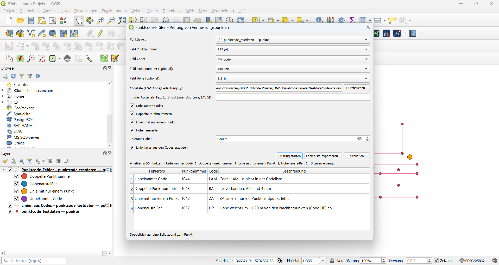
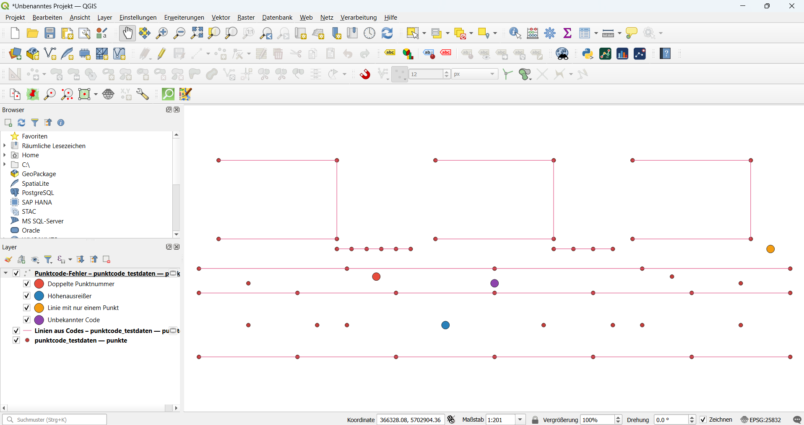
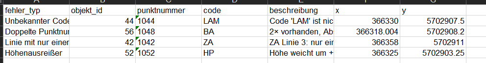
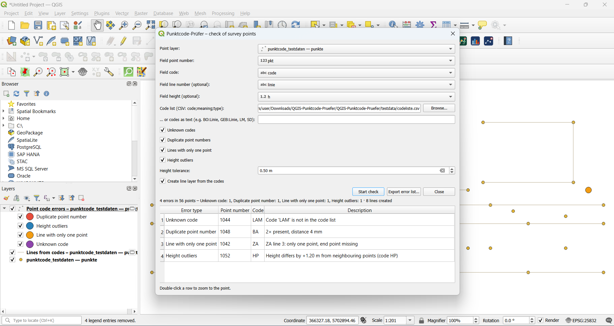

# QGIS Punktcode-Prüfer – Check of Survey Points with Codes

[English](#qgis-punktcode-prüfer--check-of-survey-points-with-codes) | [Deutsch](#deutsch)

**Punktcode-Prüfer** is a QGIS plugin (Python / PyQGIS) that checks the points of a topographic survey – point number, code, line number and height – against a **code list** before the as-built plan is made. All errors are listed in a table, shown as a coloured point layer on the map, and each error can be zoomed to with a double click. Optionally a **line layer is created from the codes**.



---

## Checks

| Check | What it finds |
|---|---|
| **Unknown codes** | Points whose code is not in the code list (typing errors in the field, e.g. `LAM` instead of `LM`) |
| **Duplicate point numbers** | The same point number measured twice, with the distance between the two measurements |
| **Lines with only one point** | Line codes (e.g. fence, curb) with only one point for a line number – the end point is missing |
| **Height outliers** | Points whose height differs by more than a tolerance (e.g. 0.50 m) from the median of the 4 nearest points **with the same code** – typical wrong reflector height |

**Code list:** a CSV file with the columns `Code;Bedeutung;Typ` (type = `Linie`, `Symbol` or `Punkt`) or a short text such as `BO:Linie, GEB:Linie, LM, SD`.

**Lines from codes:** points with the same line code and line number are connected in the order of the point numbers; faulty points are left out.

**Settings and language:** the selected checks, the tolerance and the code list are remembered after restarting QGIS. The interface is shown in German when QGIS runs in German, otherwise in English.

**Export:** the error list can be saved as **GeoPackage**, **Excel** (.xlsx) or **CSV** – with error type, point number, code, description and x/y coordinates.

## Test result

The repository contains a test survey (`testdata/punktcode_testdaten.gpkg`, 56 points of a street in Essen, EPSG:25832) with a code list (`testdata/codeliste.csv`, 8 codes) and 4 built-in field errors. The checks found exactly the **4 expected errors** and no false positives (height tolerance 0.50 m):

| Error type | Point | Details |
|---|---|---|
| Unknown code | 1044 | `LAM` not in the code list |
| Duplicate point number | 1048 | 2× measured, distance 4 mm |
| Line with only one point | 1042 | fence line 3: end point missing |
| Height outlier | 1052 | +1.20 m compared with the neighbouring spot heights |

From the remaining points **8 lines** (curbs, footway edge, buildings, fences) were created.







---

## Installation

**From ZIP:** download `punktcode_pruefer.zip` → in QGIS *Plugins → Manage and Install Plugins → Install from ZIP*.

**Usage:** *Vector → Punktcode-Prüfer* (or the toolbar button) → select the point layer and the fields for point number, code, line number and height → select the code list → *Start check*.

Requires QGIS 3.28 or newer (also prepared for QGIS 4).

## Repository structure

```
QGIS-Point-Code-Checker/
├── punktcode_pruefer/          # the plugin
│   ├── __init__.py
│   ├── punktcode_pruefer.py    # main class: menu, check, error layer, line layer, export
│   ├── checks.py               # checks in pure Python (testable without QGIS)
│   ├── dialog.py               # dialog without .ui file
│   ├── i18n.py                 # German / English
│   ├── metadata.txt
│   ├── icon.png
│   └── LICENSE
├── testdata/
│   ├── punktcode_testdaten.gpkg
│   ├── punktliste.csv
│   └── codeliste.csv
├── images/
│   ├── 01_punktcode_result.png
│   ├── 02_map_errors_lines.png
│   ├── 03_export_excel.png
│   └── 04_english_interface.png
├── LICENSE
└── README.md
```

## Tools

Python · PyQGIS · Qt · QGIS

## License

MIT License – see [LICENSE](LICENSE)

---
---

# Deutsch

[English](#qgis-punktcode-prüfer--check-of-survey-points-with-codes) | [Deutsch](#deutsch)

Der **Punktcode-Prüfer** ist ein QGIS-Plugin (Python / PyQGIS), das die Punkte einer topografischen Aufnahme – Punktnummer, Code, Liniennummer und Höhe – gegen eine **Codeliste** prüft, bevor der Bestandsplan erstellt wird. Alle Fehler werden in einer Tabelle angezeigt, als farbiger Punktlayer auf der Karte dargestellt und lassen sich per Doppelklick anzoomen. Optional wird ein **Linienlayer aus den Codes** erzeugt.


---

## Prüfungen

| Prüfung | Was gefunden wird |
|---|---|
| **Unbekannte Codes** | Punkte, deren Code nicht in der Codeliste steht (Tippfehler im Feld, z. B. `LAM` statt `LM`) |
| **Doppelte Punktnummern** | Dieselbe Punktnummer zweimal gemessen, mit Abstand der beiden Messungen |
| **Linien mit nur einem Punkt** | Liniencodes (z. B. Zaun, Bordstein) mit nur einem Punkt je Liniennummer – der Endpunkt fehlt |
| **Höhenausreißer** | Punkte, deren Höhe um mehr als eine Toleranz (z. B. 0,50 m) vom Median der 4 nächsten Punkte **mit gleichem Code** abweicht – typisch: falsche Reflektorhöhe |

**Codeliste:** CSV-Datei mit den Spalten `Code;Bedeutung;Typ` (Typ = `Linie`, `Symbol` oder `Punkt`) oder ein kurzer Text wie `BO:Linie, GEB:Linie, LM, SD`.

**Linien aus Codes:** Punkte mit gleichem Liniencode und gleicher Liniennummer werden in der Reihenfolge der Punktnummern verbunden; fehlerhafte Punkte werden weggelassen.

**Einstellungen und Sprache:** gewählte Prüfungen, Toleranz und Codeliste bleiben nach einem Neustart von QGIS erhalten. Die Oberfläche ist Deutsch, wenn QGIS auf Deutsch läuft, sonst Englisch.

**Export:** die Fehlerliste kann als **GeoPackage**, **Excel** (.xlsx) oder **CSV** gespeichert werden – mit Fehlertyp, Punktnummer, Code, Beschreibung und x/y-Koordinaten.

## Testergebnis

Das Repository enthält eine Testaufnahme (`testdata/punktcode_testdaten.gpkg`, 56 Punkte einer Straße in Essen, EPSG:25832) mit Codeliste (`testdata/codeliste.csv`, 8 Codes) und 4 eingebauten Feldfehlern. Die Prüfungen fanden genau die **4 erwarteten Fehler** und keine Fehlmeldungen (Höhentoleranz 0,50 m):

| Fehlertyp | Punkt | Details |
|---|---|---|
| Unbekannter Code | 1044 | `LAM` nicht in der Codeliste |
| Doppelte Punktnummer | 1048 | 2× gemessen, Abstand 4 mm |
| Linie mit nur einem Punkt | 1042 | Zaunlinie 3: Endpunkt fehlt |
| Höhenausreißer | 1052 | +1,20 m gegenüber den benachbarten Höhenpunkten |

Aus den übrigen Punkten wurden **8 Linien** (Bordsteine, Gehweghinterkante, Gebäude, Zäune) erzeugt.


---

## Installation

**Aus ZIP:** `punktcode_pruefer.zip` herunterladen → in QGIS *Erweiterungen → Erweiterungen verwalten und installieren → Aus ZIP installieren*.

**Bedienung:** *Vektor → Punktcode-Prüfer* (oder Knopf in der Werkzeugleiste) → Punktlayer und Felder für Punktnummer, Code, Liniennummer und Höhe wählen → Codeliste wählen → *Prüfung starten*.

Benötigt QGIS 3.28 oder neuer (auch für QGIS 4 vorbereitet).

## Werkzeuge

Python · PyQGIS · Qt · QGIS

## Lizenz

MIT-Lizenz – siehe [LICENSE](LICENSE)
